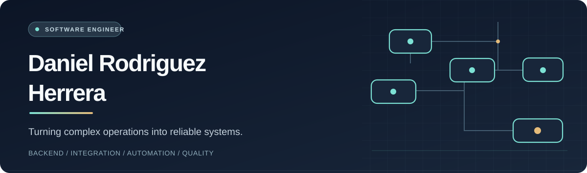

 

**Full Stack Development** · **Systems Integration** · **Process Automation**

---

## About me

I'm an **Information and Communication Technology engineer** building and maintaining software since **2021**, first at **izzi telecom** and now at **BBVA México**.

I enjoy turning complex operational problems into systems that work. It might start with an incident, a repetitive manual task, or two applications that don't communicate. My approach is to **understand the root cause, map the business rules, implement the solution, and validate the outcome**.

My work spans APIs, backend services, databases, and web interfaces. Outside my day job, I lead independent software projects from product definition through development and testing, using AI-assisted development as part of a reviewable engineering process.

## What I build

| Focus | How I approach it |
| :-- | :-- |
| **Full-stack applications** | Backend services, REST APIs, relational data models, and practical web interfaces |
| **Systems integration** | Connecting services and data to reduce manual hand-offs |
| **Process automation** | Turning business rules into configurable assignment, prioritization, and notification workflows |
| **Reliability & recovery** | Root-cause analysis, retry strategies, failure handling, and operational controls |
| **Engineering delivery** | Automated tests, CI workflows, environment separation, and documented decisions |

## Professional experience

### BBVA México 2024 – Present

**Software engineering · Integration · Operational reliability**

- Investigated saturation and failure handling in a bulk email processing service, then proposed and implemented a redesign with prioritization and retry mechanisms. **The change was approved and implemented; production enablement is still pending.**
- Work across applications, APIs, and operational workflows to trace incidents to their causes and turn improvement proposals into working software.

### izzi telecom 2021 – 2024

**Full-stack development · Internal business applications**

- Built a **rule-based incident assignment system** for call center agents, supporting configurable routing and per-area quotas.
- Developed and maintained internal applications across backend, databases, and web interfaces using Laravel, PHP, JavaScript, Node.js, Vue.js, MySQL, and SQL Server.

## Featured projects

### 01 / Nexo

**SaaS for professional practices in Mexico** · *In development*

A modular platform for independent dental and accounting practices, shaped by conversations about appointments, fees, documents, and collaboration.

I lead product definition, priorities, acceptance criteria, and delivery review. Development combines a navigable prototype, backend work, and automated checks, with attention to permissions, straightforward workflows, and controlled operating costs.

`Python` · `FastAPI` · `PostgreSQL` · `JavaScript` · `Firebase Authentication` · `Playwright` · `GitHub Actions`

**Current status:** In development and commercial validation. Private repository; not a production service.

### 02 / Shalom

**Community software · Volunteer initiative** · *In development*

Software for **Iglesia Cristiana Shalom** covering children's ministry workflows and a broader platform for families, volunteers, and administrators.

The work includes an existing **QR attendance system for Shalom Kids** and a separate **community platform prototype**. I lead requirements, workflow design, development with AI assistance, documentation, and usability review.

The public walkthrough uses fictional data. The future React/Django foundation is separate from — and does **not yet replace** — the operational Kids system.

`Google Apps Script` · `Python` · `Django REST Framework` · `PostgreSQL` · `React` · `TypeScript` · `Playwright` · `Docker`

**Explore:** [Platform walkthrough](https://danielherrodri.github.io/shalom-plataforma/bosquejo.html) · [Public demo](https://danielherrodri.github.io/shalom-plataforma/)

**Current status:** Public prototype and version 1 foundation in development; source repository is private.

### 03 / AI-assisted development methodology

**Reusable engineering workflow** · *Open repository*

A reusable template built from lessons learned in my own projects. It separates implementation from independent review and brings together project-control documents, decision records, CI checks, release automation, and configuration validation.

AI helps execute the work; **I define the goals, acceptance criteria, evidence, and final delivery decisions**.

`Markdown` · `Python` · `GitHub Actions`

**Explore:** [Repository and methodology (Spanish)](https://github.com/danielherrodri/plantilla-metodologia-desarrollo-ia)

## Technical toolkit

Tools I've used across professional work and independent projects:

| Area | Technologies |
| :-- | :-- |
| **Languages** | Java · Python · PHP · JavaScript · TypeScript · SQL |
| **Backend** | Laravel · Django · Django REST Framework · FastAPI · Node.js |
| **Frontend** | HTML · CSS · Vue.js · React · Vite |
| **Databases** | MySQL · SQL Server · PostgreSQL |
| **Quality & delivery** | Playwright · Git · GitHub Actions · Docker |
| **Cloud & identity** | Google Cloud · Cloud Run · Firebase Authentication |

## Beyond code

I run **[NoMeVendasHumo.mx](https://instagram.com/nomevendashumo.mx)**, a Spanish-language project about fabrics, materials, and build quality. I explore what products are made of and whether their construction supports their marketing claims.

That curiosity carries over to engineering: **understand how something works, then check the evidence.**

---

**Let's connect**

[LinkedIn](https://www.linkedin.com/in/daniel-rodriguez-herrera) · [Email](mailto:daniel199907@gmail.com) · Cuernavaca, Morelos, Mexico

Systems that solve real problems. Engineering backed by evidence.

